# Layout Learner

Layout Learner teaches alternate keyboard layouts (Dvorak, Colemak, Colemak-DH, Workman, or one you design yourself) on the physical board you actually own: a 60% or full-size ANSI board, an ortholinear grid, or a split ergonomic keyboard. You can practise without touching your OS keyboard settings, follow a course that is generated for whichever layout you pick, and watch 3D hands show which finger goes where.

**Try it: https://layout-learner.vercel.app**

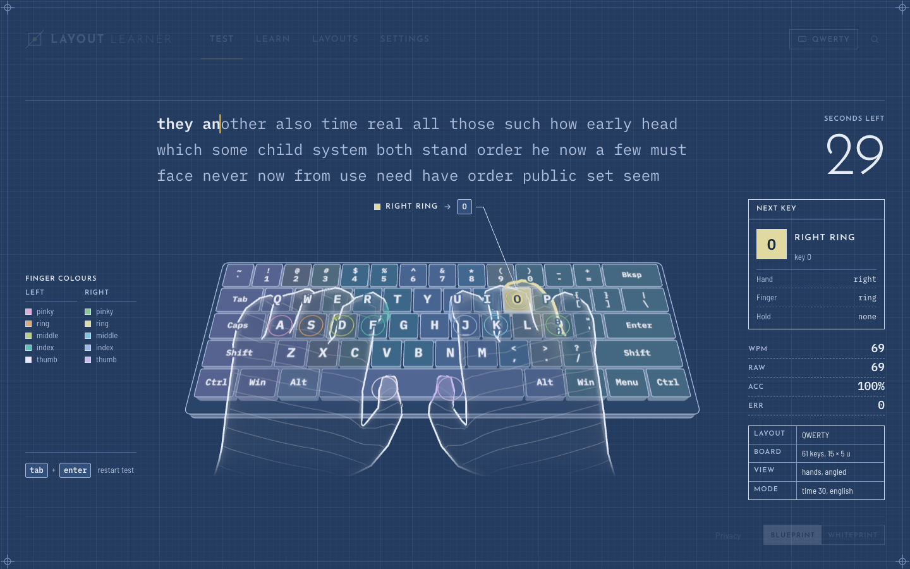

## Build Status

[](https://layout-learner.vercel.app/)

## Contents

**Using the app**

- [Getting started in 60 seconds](#getting-started-in-60-seconds)
- [What it does](#what-it-does)
- [Keyboard shortcuts](#keyboard-shortcuts)
- [FAQ](#faq)

**For developers**

- [Quick start](#quick-start)
- [How it works](#how-it-works): [architecture overview](#architecture-overview), [keystroke pipeline](#keystroke-pipeline), [layout engine](#layout-engine-liblayout), [typing engine](#typing-engine-libtyping), [lessons](#lessons-liblessons-componentslearn), [3D hands](#3d-hands-libhands-componentshands), [persistence](#persistence)
- [Adding a layout or a board preset](#adding-a-layout-or-a-board-preset)
- [Project structure](#project-structure)
- [Development workflow](#development-workflow)
- [Deployment](#deployment), [Contribution Guide](#contribution-guide), [Roadmap](#roadmap)

---

# Using the app

## Getting started in 60 seconds

1. **Pick your layout and board.** Open **Layouts** and choose a layout (QWERTY, Dvorak, Colemak, Colemak-DH, Workman, ...) on the board that matches your keyboard (ANSI 60%, full size, ortholinear or one of the split boards). Press "Use this layout".
2. **Turn "Emulate layout" on** (unless your OS is already set to that layout). It is off by default, so the app trusts the characters your OS produces. With emulation on, your OS stays on QWERTY and the app translates each physical key press into what your chosen layout would type there, so there is nothing to change in your OS settings. The toggle sits next to the keyboard guide on the Test and lesson pages, and in **Settings**. If you start typing and your keys look like QWERTY, the app offers to turn it on for you.
3. **Start lesson 1 on Learn.** The course is generated for your layout and starts with the home row. Each lesson shows the new keys, asks you to press them, then runs short typing drills. Every lesson can be started at any time; the course map highlights the next one you have not passed yet.
4. **Measure yourself on Test.** The Test page is a plain typing test (time or words mode) that uses your layout. Use it to track speed and accuracy, or to run a drill on the keys you missed.

If a guide gets in the way, switch off the 3D hands, the on-screen keyboard or the finger colours in **Settings** (or from the command palette) as you improve.

### What it does

- **Typing test** (`/`): time mode (15, 30, 60 or 120 s) or words mode (10, 25, 50 or 100 words), three word lists (English 200, English 1k, code), optional punctuation and numbers. Live WPM and accuracy, a per-second results chart, consistency, and a "practice weak keys" drill built from the keys you missed.
- **Lessons** (`/learn`): a course generated for the active layout, home row first, then top and bottom rows, capitals, numbers and punctuation. Each lesson introduces a few keys, then runs short drills. Lessons are graded with 1 to 3 stars. All lessons are open, so you can start anywhere; the first lesson you have not passed yet is marked as next up and the Continue button leads to it.
- **3D hands**: a rigged pair of hands over a 3D keyboard reaches for the next key with the correct finger, holds Shift with the opposite hand for capitals, and taps keys as you type. The panel keeps its size while the 3D scene loads (a slim progress bar shows while the three.js code and the hand model download, so nothing on the page jumps). When the word you are typing contains a typo, the guide points at Backspace (with its finger, "fix the typo") until the word is a correct prefix again; once you move on with Space it goes back to the next letter. A 2D keyboard with finger colours is always available as an alternative, and takes over automatically if WebGL is unavailable or the scene fails to load.
- **Layouts** (`/layouts`): a gallery with per-layout analysis (finger load, home-row share, same-finger bigrams, what moved relative to QWERTY), and an editor for custom layouts that accepts [keyboard-layout-editor](https://www.keyboard-layout-editor.com/) raw data, with live preview, import and export.
- **Layers**: small split boards keep digits and many symbols on layers (Lower, Raise, Fn). While you hold a layer key the other keys type different characters, so the keyboard guide highlights the layer key as a held key, shows that layer's characters on the board and tells you which thumb to hold it with, and the course adds lessons for each layer. Only momentary layers are supported (hold to use). Split presets come with suggested default layers; they are a guess, not any firmware's real map, so edit them in the layout editor's **Layers** view to match yours. The browser never sees layer keys, so typed characters are matched as usual. You can import hold-to-activate layers from a QMK (keymap.json or keymap.c), ZMK (.keymap) or Vial (.vil) file with **Import keymap** in the Layers view.
- **Layout emulation**: with "Emulate layout" on, your OS stays on QWERTY and the app translates each physical key press into the character your chosen layout would type there. It is off by default (the app trusts the characters your OS sends, which is right when your OS is already set to the layout); if your first keystrokes match QWERTY instead of the layout, a small dismissible hint offers to turn it on.
- **Board types**: ANSI 60%, full size with numpad, ortholinear, and split or ergonomic boards (columnar stagger, rotated thumb clusters), including Corne (3x5 and 3x6), Ferris Sweep, Atreus, Kyria, Iris, Lily58, Sofle, Moonlander and ErgoDox. See `lib/layout/presets.ts` for the current list. Board geometry is approximated from the real boards.
- **Themes and settings**: six themes (Tide, Paper, Dusk, Moss, Ember, Glacier), text size, smooth caret, error sound, toggles for the keyboard, hands and finger colours.
- **Command palette and shortcuts**: `Ctrl/Cmd+K` (or `Esc` when nothing else claims it) opens a palette to jump between pages, switch themes with live preview, toggle settings and change test mode. In the test, `Tab` then `Enter` restarts, `Esc` starts a new test while one is running, and `Ctrl/Alt+Backspace` deletes a word.
- **Optional accounts and sync**: off unless the deployment is configured for it. When enabled, you can sign in with GitHub or Google to sync lesson progress, settings and custom layouts across devices. See [docs/accounts-setup.md](docs/accounts-setup.md).

| | |
|---|---|
|  | 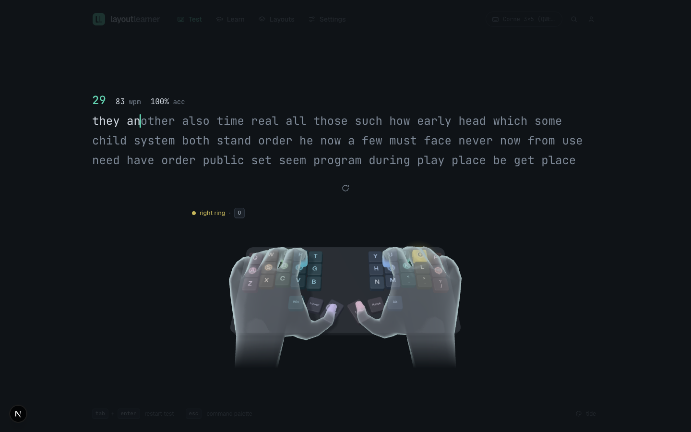 |
| **Typing test** with 3D hands reaching for the next key. | The same test on a split board: each hand is fitted to its own half. |
| 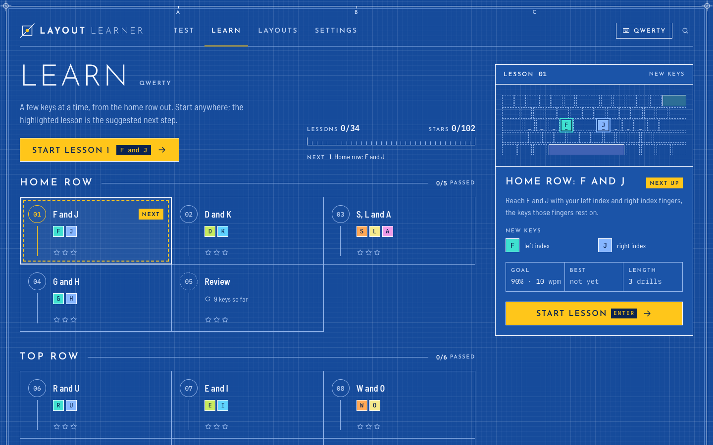 | 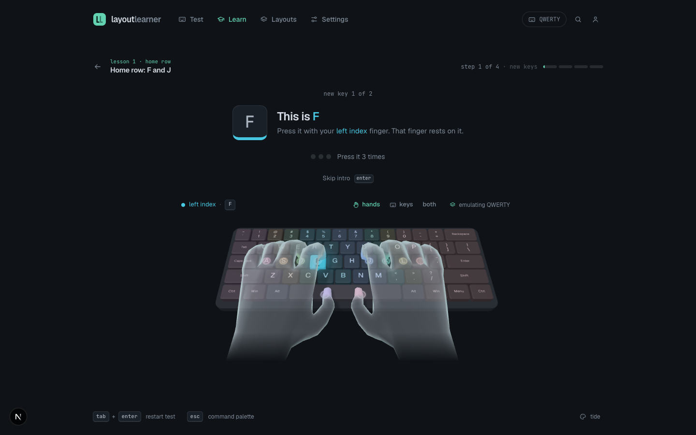 |
| **Course map** generated for the active layout. | **A lesson**: new keys first, then drills. |
| 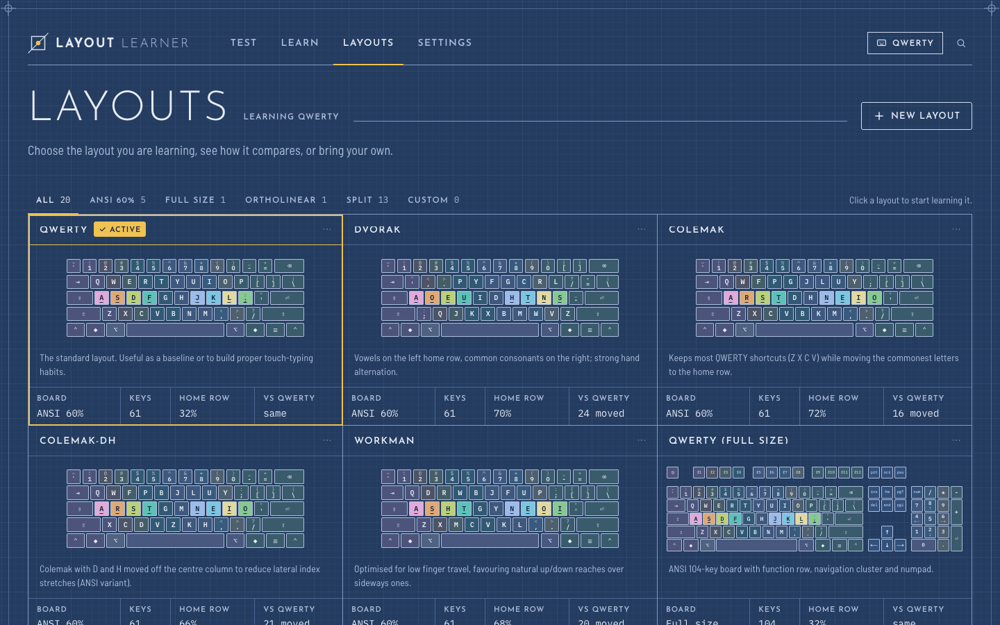 | 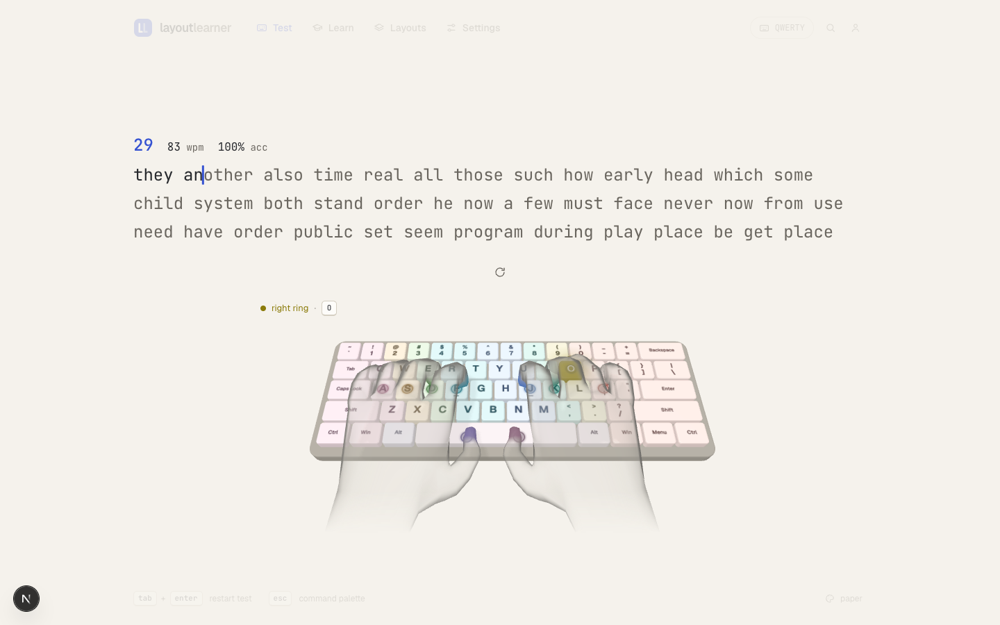 |
| **Layouts** gallery with per-layout analysis and a custom layout editor. | One of the two light themes (Paper). |

Everything runs in the browser. By default, settings, custom layouts and lesson progress are stored in `localStorage` and nothing is sent to a server. If the deployment has accounts enabled and you sign in, those three things (except a few device-specific settings: `emulateLayout`, `showHands`, `fontSize`) are also kept in a copy on the server so your devices stay in step; if you never sign in, nothing is sent. What is stored is described on the site's `/privacy` page; the owner setup is in [docs/accounts-setup.md](docs/accounts-setup.md).

### Keyboard shortcuts

| Keys | Where | What it does |
|---|---|---|
| `Tab`, then `Enter` | Test, lesson drills | Restart. `Tab` moves focus to the restart button from anywhere, `Enter` presses it. |
| `Esc` | Test, while a test is running | Start a new test. |
| `Esc` | Test, when no test is running; most other pages | Open the command palette. |
| `Esc` | Lesson | Back to the course (a dialog may ask first if you would lose progress). On the result screen it goes straight back. |
| `Enter` | Lesson intro and between drills | Continue to the next step. |
| `Enter` | Lesson result screen | The highlighted action: next lesson if you passed, otherwise retry (back to the course if there is no next lesson). |
| `Ctrl/Cmd+K` | Anywhere | Open or close the command palette: jump between pages, switch themes with live preview, toggle settings, change test mode. Move with the arrow keys (or `Ctrl+N` / `Ctrl+P`), `Enter` runs. |
| `Backspace` | Test, lessons | Delete a character. |
| `Ctrl+Backspace` or `Alt+Backspace` | Test, lessons | Delete a word. |

Other browser and OS shortcuts (copy, reload, switching tabs) are left alone while you type.

### FAQ

**Do I need to change my OS keyboard layout?**
No. Turn on "Emulate layout" (the toggle by the keyboard guide, or Settings) and the app reads which physical key you pressed and types the character your chosen layout has there, whatever your OS is set to. Leave it off if your OS is already set to that layout. It is off by default; if you have not changed your OS layout and your keystrokes look like QWERTY, the app shows a hint with a one-click "Turn on".

**Does it work with my split or ortholinear keyboard?**
Yes, if the board is on the Layouts page or you describe it yourself. There are presets for Corne (3x5 and 3x6), Ferris Sweep, Atreus, Kyria, Iris, Lily58, Sofle, Moonlander and ErgoDox, plus ortholinear grids. Fingers and home keys are worked out from the key positions, and board geometry is approximated from the real boards, so check the colours on the keyboard preview.

**Can I use my own layout or board?**
Yes. The editor on the Layouts page takes raw data from [keyboard-layout-editor.com](https://www.keyboard-layout-editor.com/), shows a live preview and warns about problems (missing letters, duplicate characters, no fingers found). Custom layouts can be exported and imported again.

**Where is my progress stored? Is there an account?**
In your browser's `localStorage`. By default there is no account and nothing is sent to a server, so progress does not follow you to another browser or device, and "Clear all data" in Settings removes it. If the site you are using has accounts switched on, you can sign in with GitHub or Google to keep lesson progress, settings and custom layouts in step across devices; the `/privacy` page says what is stored.

**Do you support layers?**
Yes, the simple kind. A layer is a set of characters that appears while you hold a layer key such as Lower, Raise or Fn. Split presets ship with suggested layers, and you can add or change them for a custom layout in the editor's Layers view. The guide and the lessons then tell you which layer key to hold. Only hold-to-use layers are supported: toggles and one-shot layers are not (an imported keymap skips them). The browser cannot see which layer your keyboard is on, so layers only affect guidance and lessons; the characters you type are checked as before.

---

# For developers

## Quick start

```bash
git clone https://github.com/lighteningAB/LayoutLearner.git
cd LayoutLearner
yarn install
yarn dev
```

Then open http://localhost:3000. Other scripts: `yarn build`, `yarn start`, `yarn typecheck`, `yarn verify` (see [Development workflow](#development-workflow)). Google Chrome is needed only for the verify script.

The stack is Next.js 15 (app router), React 19, TypeScript, Tailwind CSS v4, three.js with `@react-three/fiber`, and `json5` for parsing layout data.

## How it works

The app is built around one data type, `ParsedLayout` in `lib/types.ts`: a list of `LayoutKey`s, each with a position and size in key units (1u is one standard key), its legends, the characters it types (`base`, `shifted`), a `KeyboardEvent.code`, a `finger`, an `isHome` flag, and an optional rotation. Every feature (2D keyboard, typing, lessons, 3D hands, analysis) reads only that structure, so supporting a new board means producing a good `ParsedLayout`, not changing the features.


### Architecture overview

Read this left to right: each route renders components, components call into `lib` modules, and three stores persist to `localStorage`. The layout engine feeds everything else.

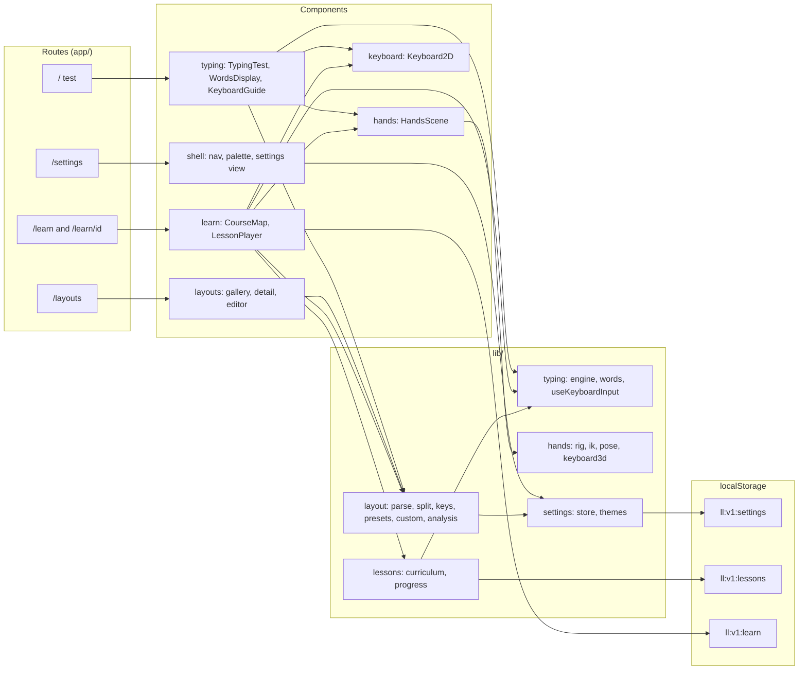

### Keystroke pipeline

Follow one key press from the browser event to what is drawn. The only branch is emulation: with it on the physical key decides the character, with it off the character decides the key.

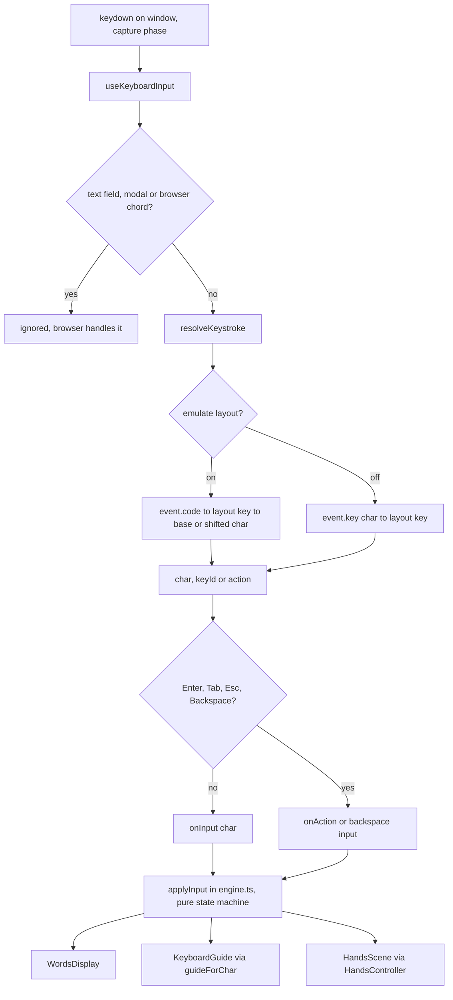

The same hook drives the lessons. A wrong character also flashes the key (`expectedChar`).

### Layout engine (`lib/layout`)

Layout parsing turns KLE text into a `ParsedLayout`. Read the diagram top to bottom: geometry first, then one of three board-type branches decides the `code`, `finger` and `isHome` of every key.

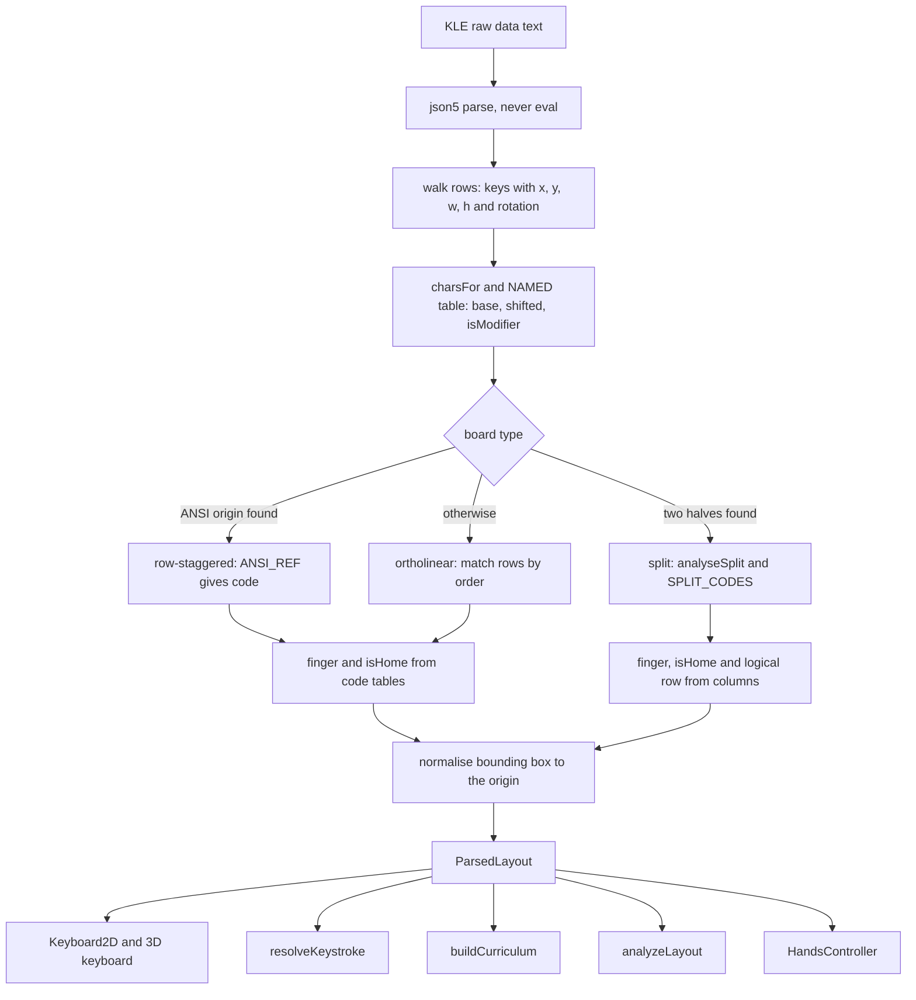

**Parsing** (`parse.ts`). `parseLayout(source, name?)` reads keyboard-layout-editor (KLE) raw data. The source is parsed with `json5`, never `eval`, so the unquoted property names KLE exports (`{x:0.5,w:2}`) work and pasted text cannot execute code. It also accepts rows without the outer brackets. Syntax errors become `LayoutParseError`s carrying a line and column, which the editor shows in place. There is a hard cap of 400 keys per layout.

The walk follows KLE semantics: a string is a key, an object changes properties for the following keys (`x`, `y` offsets, `w`, `h`, and rotation `r`, `rx`, `ry`), and each row advances `y` by one. Keys with a rotation store `{angle, cx, cy}` (degrees clockwise about a point in key units). After the walk, positions are normalised so the bounding box (with rotation applied) starts at the origin.

**Characters and named keys.** From the legends, `charsFor` derives `base` and `shifted`. With two legends, KLE order is shifted then base (`"!\n1"`). A single letter legend gives its lower and upper case. Names like `Shift`, `Caps Lock`, `Bksp` or `Esc` are looked up in the `NAMED` table (`parse.ts`) to get their `code`, whether they are modifiers, and, through `keyAction`, whether they act as Backspace, Enter, Tab or Escape in the typing test. Judging by label means a layout that relabels Caps Lock as Backspace behaves that way under emulation.

**Codes, fingers and home keys.** These are derived differently per board type. The first match wins:

1. *Row-staggered ANSI/ISO* (`findAnsiOrigin`): the parser looks for rows starting with a 1.5u, 1.75u and 2.25u (or 1.25u) key, which identifies the QWERTY alphanumeric block. Each key's offset from that origin is looked up in a table of ANSI positions (`ANSI_REF`) to get its `code`. Fingers come from a fixed code-to-finger table (`FINGER_BY_CODE`) and home keys are `A S D F J K L ;` plus the space bar. Remaining keys in the main block inherit the finger of the nearest home-row column. Full-size boards also get the navigation cluster and numpad codes.
2. *Split boards* (`analyseSplit` in `split.ts`, with `detectHalves` in `geometry.ts`): see below.
3. *Anything else, such as ortholinear grids* (`assignCodesByColumn`): rows holding at least five letters are matched, in order, to the QWERTY top, home and bottom row code sequences, and a number row is matched the same way. Fingers then come from the codes as in the ANSI case.

Step 3 is a heuristic: it matches by order within a row, not by position on the board, so it expects a recognisable block of letter rows.

**Split boards.** The diagram shows the order of steps and the sketch shows what ends up on each key. Read the sketch as the left half seen from above, with the gap between the halves on its right; the right half is the mirror image.

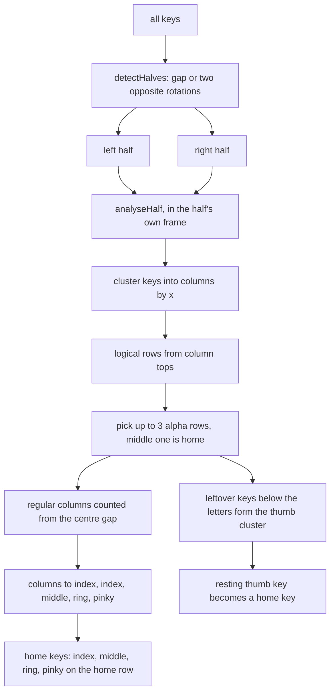

```
        left half, seen from above                       centre gap
   pinky     ring    middle    index    index(inner)         |
   col 5     col 4    col 3     col 2      col 1             |
  .-----.  .-----.  .-----.  .-----.    .-----.              |
  |  Q  |  |  W  |  |  E  |  |  R  |    |  T  |    top row   |
  '-----'  '-----'  '-----'  '-----'    '-----'              |
  .-----.  .-----.  .-----.  .-----.    .-----.              |
  | [A] |  | [S] |  | [D] |  | [F] |    |  G  |    home row  |
  '-----'  '-----'  '-----'  '-----'    '-----'              |
  .-----.  .-----.  .-----.  .-----.    .-----.              |
  |  Z  |  |  X  |  |  C  |  |  V  |    |  B  |    bottom    |
  '-----'  '-----'  '-----'  '-----'    '-----'              |
     thumb cluster, rotated, below the letters: [rest] key + others
   [ ] = home key (the resting thumb key is one too).
   The inner column (col 1) is an index stretch.
   Letters above are QWERTY labels for the position; your layout puts its own letters there.
```

A board is treated as split when `detectHalves` finds a clear vertical gap (at least 0.75u) near the middle of the main block, with a comparable number of keys on each side, or, when there is no gap, two large groups of keys with opposite rotation (Atreus-style). Small rotated groups such as thumb clusters are ignored while looking for the gap. This is purely geometric, so it works for any letter arrangement. `analyseHalf` then works on each half in its own frame:

- It undoes the rotation most keys share, clusters keys into **columns** by x position, and builds **logical rows** from how far each column's top key sits from its neighbour's (columnar stagger is less than a key, so those keys share a row).
- It picks the up-to-three consecutive rows holding the most letters as the alpha rows (legends are used only to tell character rows from the number row and modifier rows). The middle one is the home row.
- Columns with a normal-height key in every alpha row are the **regular columns**, counted outward from the centre gap. The columns map to fingers in order: inner column and index home column both go to the index finger, then middle, ring, pinky. Extra columns beyond the pinky extend the pinky; an extra inner column counts as an index stretch.
- Keys below the alpha rows that do not continue a finger column, and keys rotated differently from the main block and sitting below the letters, form the **thumb cluster**. The resting thumb key is the cluster key nearest a point a little inside of and about two key-heights below the index home key. If a half has no separate cluster (a plain ortholinear half), the keys under the index columns are given to the thumb.
- Home keys are the index-home, middle, ring and pinky columns on the home row, plus the resting thumb key.

`assignCodesBySplit` then gives character keys in the five letter columns the QWERTY position of the same half, column and row (`SPLIT_CODES`), and other character keys the position that types the same character on QWERTY if it is free. `applySplit` writes `finger`, `isHome` and a logical `row` back onto the keys, because KLE row order on columnar boards is arbitrary.

**Known limits.** Layer keys (`Fn`, `Lower`, `Raise`) are modifiers without a code; layers are an extra, separate data set (see `lib/layout/layers.ts`), only hold-to-use layers exist, and the characters on keys themselves are still only the base and shifted legend. `Hyper` does nothing. A key's characters must be single letters or ASCII punctuation. If the same character is on two keys, the first one wins (and the editor warns). If the halves cannot be recognised (fewer than four finger columns, very unbalanced halves), the board falls through to the column-matching heuristic. Finger assignment on an unusual board can be wrong; the layout editor warns when no fingers or home keys could be found.

**Presets and custom layouts.** `presets.ts` holds the built-in layouts as KLE raw data (the same format users paste), with a `family` (`ansi-60`, `ansi-100`, `ortho`, `split`). `custom.ts` validates custom layouts (`checkSource`: 50 KB and 300-key limits, parse errors with line numbers, warnings for missing letters, duplicate characters and missing fingers) and handles import and export of KLE JSON. `useActiveLayout()` resolves `settings.layoutId` to a `ParsedLayout`, falls back to QWERTY if a custom layout no longer parses, and never throws.

**Analysis** (`analysis.ts`). `analyzeLayout` weights the built-in English word list with a Zipf-Mandelbrot curve to get character and bigram frequencies, then reports coverage, row shares (relative to the home row, using the logical row on split boards), per-finger and per-hand load, and the same-finger bigram rate with the worst offenders. `diffFromQwerty` compares each key with what QWERTY has at the same `code`. The Layouts page uses both.

### Emulation and keystroke resolution (`lib/layout/keys.ts`)

`resolveKeystroke(layout, event, {emulate})` turns a browser key event into `{char, keyId, action}`.

- **Emulate on**: the OS is on QWERTY, so the layout key is found by physical position, `event.code`, and the character is its `base` or, with Shift held, its `shifted`. Dead keys, IME composition and the OS layout are irrelevant because only `code` is used.
- **Emulate off** (default): the OS already produces the layout, so `event.key` is trusted and mapped back to a layout key by character.

Enter, Tab, Escape and Backspace are returned as `action`s. `keyForChar` goes the other way, from a character to the key that types it and, if Shift is needed, the Shift key on the opposite hand from that key. `guideForChar` in `components/typing/KeyboardGuide.tsx` builds on it to describe "next key, Shift, finger" for the guides.

`useKeyboardInput` is the single window-level listener, shared by the test and the lessons. It listens in the capture phase, ignores events while a text field, modal, menu or the palette has focus, lets browser and app chords through (Ctrl/Alt+Backspace is the exception), ignores held-key repeats, tracks which keys are down for the on-screen keyboard, and flashes the key when the typed character differs from `expectedChar`. Every character keystroke is also reported through `onKeystroke(char, expected)`; `useEmulationHint` (`components/typing/EmulationHint.tsx`) uses it while emulation is off: when most of the first few keystrokes equal what QWERTY types at the expected key's physical position (`code`), it shows a dismissible hint (once per browser session) with a "Turn on" action.

### Typing engine (`lib/typing`)

`engine.ts` is a pure state machine with no React, DOM or timers: `createTest`, `applyInput(state, input, timeMs)`, `tick`, `finish`, and selectors (`getWords`, `getCaret`, `getLiveStats`, `getResult`). Every function returns a new state. `useTypingTest` is a thin React wrapper that owns the clock (a tick while running) and refills words in time mode. It attaches no listeners of its own.

Rules follow monkeytype: space commits a word, untyped letters are "missed", letters past a word's end are "extra" (up to a limit), the timer starts on the first character, and Backspace at the start of a word returns to the previous word only if it was wrong.

- `wpm` = (characters of fully correct words plus the spaces after them) / 5 / minutes.
- `raw` = every typed character plus spaces, right or wrong, / 5 / minutes.
- `accuracy` = correct keystrokes / all keystrokes, so corrected mistakes still count.
- `consistency` summarises how steady the per-second raw speed was.

The result also carries per-character hit, miss and latency data and a mistype map, used for the weak-keys drill (`components/typing/practice.ts`). Results are shown, not stored.

`words.ts` generates text from a seeded PRNG (`createRng`, mulberry32): the same seed and config give the same text. `createWordStream` is an endless source (time mode keeps asking for more) and `generateText` wraps it. With `allowedChars`, only words typable with those characters are used, and `pseudoWord` fills in pronounceable made-up words when too few real words remain, which is what makes early lessons possible on any layout.

### Lessons (`lib/lessons`, `components/learn`)

A lesson is a small state machine in `LessonPlayer`. Read it from the course map: a lesson that introduces keys starts with the intro, a review goes straight to the drills. Lessons are never locked: the course map only marks the first lesson that is not passed as "next up".

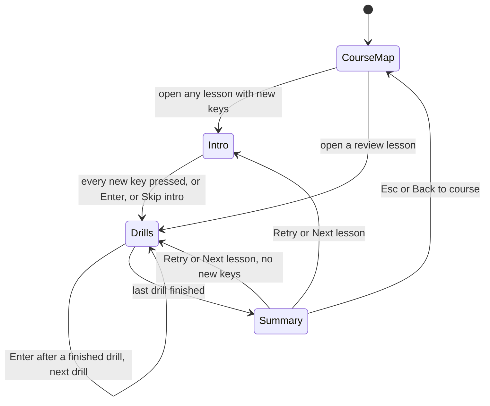

On the summary, `gradeLesson` gives 0 to 3 stars. One star or more passes the lesson, saves the result with `recordLessonResult`; the next lesson then becomes the suggested one on the course map.

`buildCurriculum(layout)` in `curriculum.ts` derives a whole course from `finger`, `isHome`, `row` and the characters of the keys, so it works for any layout:

1. Find the home row (the row with the most home keys) and the unique letters on the keys.
2. For each row in order, home, top, bottom, then any other rows, split its keys into small groups by finger (`fingerGroups`: for each finger, the keys nearest its home column first, left and right hand together) and add a lesson per group, then a review of that row.
3. Add capitals (Shift on the opposite hand), numbers, punctuation (common symbols first), and a final review.

Each lesson has `newChars`, the cumulative known `chars`, `focusKeyIds` for the guides, a few `drills` (word lists, easiest first) and a goal (`GOALS` per stage). Drill words are restricted to known characters with the same filtering and pseudo-word fallback as above, and the PRNG is seeded from the layout's characters plus the lesson id, so a layout always yields the same course. `validateCurriculum` checks that every character is introduced exactly once; the `/dev/engine` harness runs it.

`gradeLesson` gives 1 star when both the accuracy and WPM goals are met, 2 stars at 95% accuracy and 1.25x the WPM goal, 3 stars at 98% and 1.5x. `lib/lessons/progress.ts` keeps the best stars, WPM and accuracy per layout and lesson. `components/learn/course.ts` joins the curriculum with progress to compute each lesson's state: completed, "current" (the first lesson not passed, the suggested next step) or available. Every lesson is startable. A custom layout gets its own course and progress, keyed by its id.

### 3D hands (`lib/hands`, `components/hands`)

Read the chain from top to bottom for one keystroke; the first two steps run only when the layout changes, the rest on every target change.

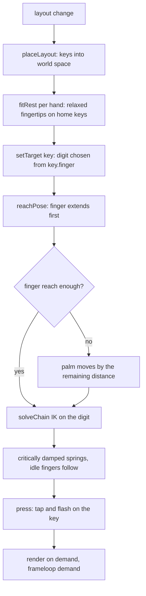

The scene is layout-agnostic: it uses only the keys' positions, `finger` and `isHome`.

- **Model** (`rig.ts`). `public/models/hand.glb` is one rigged left hand (source files are in `assets/hand/`). The right hand is the same rig mirrored in x. The bone rolls are not anatomical, so `rig.ts` derives anatomical axes (palm normal, per-finger flexion axis) from the bind pose and builds one three-joint chain per digit. Per-digit length and palm-arch corrections compensate for the model's proportions. Fingertip colours come from the theme.
- **Keyboard** (`space.ts`, `keyboard3d.ts`). `placeLayout` maps the layout into world space (1 unit is 1u, centred on the origin, key rotation about the vertical axis). `Keyboard3D` draws caps as instanced meshes bucketed by size, with key dip, flash, hold and finger-zone tints, and implements the `KeySink` interface the pose layer calls into.
- **IK** (`ik.ts`). `solveChain` solves one digit's three parameters (spread, knuckle flexion, curl) against a 3D fingertip target with a few damped Gauss-Newton steps on a finite-difference Jacobian and hard joint limits. It allocates nothing per call.
- **Posing** (`pose.ts`). `HandsController` owns both hands. `setTarget(keyId)` and `setModifier(keyId)` pick the digit from the key's `finger`. For each hand `fitRest` slides and pivots the hand so every relaxed fingertip rests on its home key in a comfortable arch, with spare reach one row up and down, and on boards with a dedicated thumb home key it also fits the thumb. How far the hands are turned inward depends on how far apart the home keys are, and a column-staggered half (`columnYaw`) lays the fingers along its own columns. To reach a key, `reachPose` has the finger do as much of the reach as is comfortable (IK must succeed without hitting a joint limit while following the key down) and moves the palm only by what is left, so letter-row keys barely move the hand and far keys move it a lot. Motion uses critically damped springs, and idle fingers follow a displaced hand. `press` plays a tap and flash on a key, in the error colour when the keystroke was wrong.
- **Rendering** (`components/hands/HandsScene.tsx`). The `Canvas` uses `frameloop="demand"`, so nothing is drawn while everything is at rest; effects call `invalidate()` and the frame loop keeps requesting frames only while `controller.update` reports movement, and pauses when the canvas is off screen or the tab is hidden. The camera is fitted to the key block and both hands and glides when the framing changes (`angled`, `top` or `front`). Colours are read from the CSS design tokens by `theme.ts` (`readTheme`, `watchTheme`), so the scene follows theme changes. `components/hands/index.tsx` loads it with `next/dynamic` and `ssr: false` (used by the dev pages). `HandsPanel` imports the scene itself so it can show real progress: the panel box has its final size from the first paint (aspect ratio plus a height clamp, `handsBoxStyle`), the scene chunk and `hand.glb` load in parallel (`lib/hands/progress.ts` carries the GLB byte progress from the loader), a slim bar with "Loading 3D hands…" appears after 150 ms (indeterminate when the size is unknown, no creeping with reduced motion), and the canvas is revealed only after its first frame with the hands at rest and the camera fitted (the scene reports `ready` from inside the frame loop). The panel root carries `data-hands-load="loading|ready|error"` and the bar `data-testid="hands-progress"`. If WebGL2 is unavailable or the scene fails to load, `HandsPanel` renders nothing and the 2D keyboard takes over.

On split boards each hand is fitted to its own half (home keys per hand, column yaw, thumb home key), so the same mechanism carries them. Outer thumb-cluster keys on large boards still need the whole hand to move; check `/dev/hands?preset=<id>` when adding a board.

### UI and design system (`components/ui`, `components/shell`, `app/globals.css`)

- **Tokens.** `app/globals.css` defines colours as CSS custom properties per theme under `[data-theme="<id>"]` (`--bg`, `--text`, `--main`, `--error`, `--key-*`, and `--finger-0` to `--finger-9` from left pinky to right pinky), mapped into Tailwind v4 through `@theme inline`, so classes like `bg-bg-alt`, `text-sub`, `border-border` and `bg-finger-3` work. Theme metadata is in `lib/settings/themes.ts`. A small inline script (`themeInitScript`) sets `data-theme` before first paint to avoid a flash.
- **Components.** `components/ui` is a small set of primitives (Button, Card, Modal, Menu, Select, SegmentedControl, Slider, Tooltip, Toast and others), previewed on `/dev/ui`. `components/keyboard/Keyboard2D.tsx` renders any `ParsedLayout`, including rotated keys, with states for highlight, pressed, error, dim and a heat value, plus finger colours and home markers.
- **Shell.** `components/shell` has the nav, footer, page header and the command palette. Pages and features add palette entries with `useRegisterCommands`; navigation links live in `nav-links.ts`. Fuzzy matching is `fuzzyScore` in `commands.ts`.
- **Routes.** `app/page.tsx` is the test, `app/learn` the course and lesson player, `app/layouts` the gallery and editor, `app/settings` the settings. `next.config.js` redirects the old `/practice` and `/stats` routes to `/`.

### Persistence

By default there is no server-side storage. Three `localStorage` keys, all under the `ll:v1:` prefix, hold the app's data:

| Key | What |
|---|---|
| `ll:v1:settings` | Settings and custom layouts (`lib/settings/store.ts`) |
| `ll:v1:lessons` | Lesson progress per layout (`lib/lessons/progress.ts`) |
| `ll:v1:learn` | Learn preferences: hands camera, show both guides (an old `unlockAll` value is ignored) (`components/learn/prefs.ts`) |
| `ll:v1:sync` | Sync sidecar, only when accounts are enabled: this device's replica of the synced document, the account link and timestamps (`lib/sync/meta.ts`) |
| `ll:v1:account` | Signed-in hint, only when accounts are enabled: tells the app whether to ask the server for a session, and signals sign-in and sign-out between tabs (`lib/auth/client.ts`) |

Each store is an external store consumed with `useSyncExternalStore`, reads defensively (corrupt or missing data reads as defaults), keeps working in memory if storage is blocked, and syncs across tabs through the `storage` event. "Clear all data" in Settings removes every `ll:v1:` key and fires a window event so the other stores reset. Statistics (history, heatmaps, charts) used to exist and were removed; the settings store deletes their old keys.

**Server copy (optional).** When the deployment has accounts enabled (a GitHub or Google provider, `NEXTAUTH_SECRET` and a Postgres `DATABASE_URL`), `next-auth` under `app/api/auth` handles sign-in with JWT sessions and `app/api/sync` stores one JSON document per account in Postgres (Neon in production, PGlite locally). The document is a state-based CRDT (`lib/sync/doc.ts`): devices exchange whole documents and merge them, so the order of syncs does not matter. When the feature is off, the sync keys above are never written and the API answers 404.

## Adding a layout or a board preset

Presets live in `lib/layout/presets.ts` as KLE raw data: rows of keys, where a string is a key and an object before it sets properties for the next key. Common properties: `w` and `h` (size in units), `x` and `y` (offset), `r`, `rx`, `ry` (rotation and its origin). A two-line legend is `"shifted\nbase"`.

```js
[{w:1.5},"Tab","Q","W","E","R","T","Y","U","I","O","P"],
[{w:1.75},"Caps Lock","A","S","D","F","G","H","J","K","L",":\n;"]
```

To add one:

1. Design the board at [keyboard-layout-editor.com](https://www.keyboard-layout-editor.com/) and copy the raw data (or write it by hand, or generate it as `presets.ts` does for the ANSI and split boards), or paste it into the custom layout editor on `/layouts` to try it first.
2. Add an entry to `PRESETS` with a unique `id`, `name`, `description`, one of the `family` values, and the `source` string.
3. Open `/dev/keyboard?preset=<id>` and check: every key has the expected finger colour, the home keys carry a marker, the listed `code` of each character key is the QWERTY position you expect (keys with no code are listed as unresolved), and the curriculum validates (`validateCurriculum`). For split boards check the thumb cluster and that halves are detected.
4. Open `/dev/hands?preset=<id>` and press keys to check the hands reach them sensibly.
5. If something is mis-assigned, the fix belongs in the board-type logic in `parse.ts` or `split.ts` (geometry rules), not in the preset.

A new layout on an existing board (for example another letter arrangement on the ANSI 60% board) needs only a new call to the `ansi60` helper in `presets.ts`: its rows are the number tail, top, home and bottom legends.

## Project structure

| Path | What |
|---|---|
| `app/` | Next.js routes: `/` (test), `/learn` and `/learn/[lessonId]`, `/layouts`, `/settings`, `/api/auth`, global CSS and tokens |
| `app/dev/*` | Development harnesses: `keyboard`, `engine`, `hands`, `ui` (development-only: 404 in production builds) |
| `lib/types.ts` | Shared types (`ParsedLayout`, `LayoutKey`, fingers) |
| `lib/layout` | KLE parser, geometry, split-board analysis, presets, custom layouts, keystroke resolution, analysis |
| `lib/typing` | Typing engine, word generation, keyboard-input hook, word lists |
| `lib/lessons` | Curriculum generator, grading, lesson progress |
| `lib/hands` | 3D hands: rig, IK, pose planning, 3D keyboard, theme |
| `lib/settings` | Settings store, themes |
| `components/typing`, `components/learn`, `components/layouts` | Test, course and lesson player, layouts gallery and editor |
| `components/hands`, `components/keyboard` | 3D scene wrapper, 2D keyboard |
| `components/ui`, `components/shell` | Design system primitives, app shell and command palette |
| `public/models/hand.glb`, `assets/hand/` | The runtime hand model and its source files |
| `scripts/verify.mjs` | Browser verification CLI |
| `lib/sync`, `lib/auth`, `lib/db` | Accounts and sync: merge core and client engine, auth config and session, Postgres/PGlite storage |
| `app/api/sync`, `components/account` | Sync API route, account UI and provider |
| `scripts/verify-sync.mjs`, `scripts/sync-property.mjs`, `scripts/sync-engine-sim.mjs`, `scripts/db.mjs` | Multi-device browser check, merge property tests, engine simulation, database migrate/dump/reset |
| `docs/accounts-setup.md` | Owner guide for enabling accounts and sync |

## Development workflow

There is no unit-test suite. The project deliberately verifies changes by driving the real app: pure modules are exercised through dev harness pages, and behaviour is checked in a real browser with `scripts/verify.mjs`.

- `yarn typecheck` runs `tsc --noEmit`.
- Harnesses (development-only: they return 404 in a production build, so use `yarn dev`): `/dev/keyboard` (layout parsing, fingers, keystroke resolution, curriculum validation; `?preset=`, `?emulate=`), `/dev/engine` (typing engine, word generation, curriculum, lesson progress; `?layout=`, `?lesson=`), `/dev/hands` (3D hands on a preset or fixture; `?preset=`, `?camera=`, `?target=`; press any key to see the hands reach it), `/dev/ui` (design system).
- `scripts/verify.mjs` drives the running dev server with headless Chrome through `playwright-core` (it needs Google Chrome installed). Steps run in order and screenshots go to `.verify/` (git-ignored). Console errors, page errors and failed requests are printed, and the exit code is 1 on any failure. Read the header of the script for all steps.

```bash
# Type a few words and read the live WPM, then take a screenshot
yarn verify goto:/ "type:hello " "text:[data-testid=live-wpm]" shot:home

# Light theme at a narrow viewport
yarn verify --light --size 390x844 goto:/layouts shot:layouts-mobile

# Screenshot a split preset in the keyboard harness
yarn verify "goto:/dev/keyboard?preset=colemak-dh-split" shot:split
```

## Deployment

The site is deployed on Vercel from the `main` branch (see the badge above). `next build` must pass; there are no server-side secrets required to run the app. Accounts and sync are optional and need environment variables and a database; see [docs/accounts-setup.md](docs/accounts-setup.md).

## Contribution Guide

Pull requests to make changes or contributions to this project are welcome. For major new features or large codebase changes please open an issue first. Before opening a pull request, run `yarn typecheck` and check your change in the running app (and in the relevant `/dev/*` harness) as described above.

## Roadmap

1. More layer types: toggle and one-shot layer keys. Hold-to-use layers, including importing them from a QMK / ZMK / Vial keymap, already work in the guide and lessons.
2. Better handling of unusual boards: more reliable finger assignment for irregular rotated or non-columnar layouts, and finishing 3D hand support for split boards.
3. Competition on top of accounts (cross-device sync already exists, see above).
4. Generating layout data from a photo of a keyboard.
5. Non-ASCII characters on keys (accents, dead keys, AltGr layers) under emulation.

## Acknowledgements

Thank you to [ijprest](https://github.com/ijprest/keyboard-layout-editor) for providing inspiration to this project.

## License

[MIT](https://choosealicense.com/licenses/mit/)
