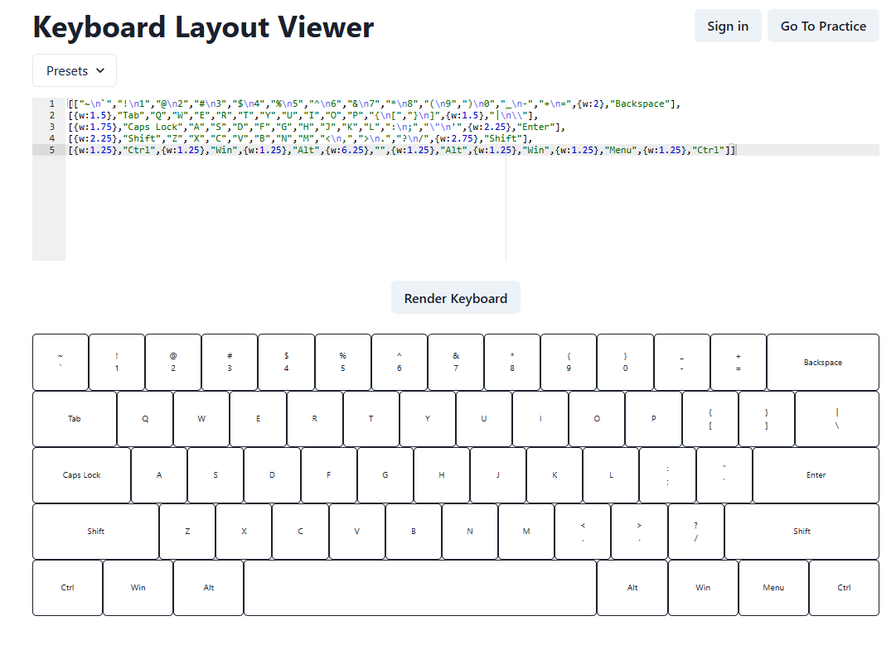

# Layout Learner

Layout learner is a web application designed to help teach anyone alternate keyboard layouts and shortcuts.



## Build Status

[](https://layout-learner.vercel.app/)

## Features

- **Typing test** (`/`) — time and word modes, live WPM/accuracy, results chart, next-key and finger guidance.
- **Lessons** (`/learn`) — a progressive course generated for whichever layout you pick, home row first.
- **3D hands** — rigged hands on a 3D keyboard show which finger reaches for the next key.
- **Layouts** (`/layouts`) — QWERTY, Dvorak, Colemak, Colemak-DH, Workman, full-size and ortholinear presets, plus custom layouts from [keyboard-layout-editor](https://www.keyboard-layout-editor.com/) raw data.
- **Layout emulation** — practise a layout without changing your OS keyboard settings.
- **Stats** (`/stats`) — progress over time, per-key heatmap, weakest keys and fingers. Stored in your browser.
- Themes, command palette (`Esc` or `Ctrl/Cmd+K`).

## Local Development

```bash
git clone https://github.com/lighteningAB/LayoutLearner.git
cd LayoutLearner
yarn install
yarn dev
```

Then open http://localhost:3000.

### Project structure

| Path | What |
|---|---|
| `lib/types.ts` | Shared types (`ParsedLayout`, `LayoutKey`, fingers) |
| `lib/layout` | KLE parser, presets, keystroke resolution, analysis |
| `lib/typing`, `lib/lessons`, `lib/stats` | Test engine, curriculum generator, local stats store |
| `lib/hands`, `components/hands` | 3D hands: rig, IK, posing, scene |
| `components/ui`, `components/shell` | Design system and app shell |
| `app/dev/*` | Development harnesses (keyboard, engine, hands, UI kit) |

### Verifying changes

`scripts/verify.mjs` drives the running dev server in headless Chrome (needs Google Chrome installed):

```bash
yarn verify goto:/ "type:hello " "text:[data-testid=live-wpm]" shot:home
```

Screenshots are written to `.verify/`. Run `yarn typecheck` for types.

## Contribution Guide

Pull requests to make changes or contributions to this project are welcome. For major new features or large codebase changes please open an issue before.

## Roadmap

1. Layers (Fn/Lower/Raise) in lessons and tests
2. Finger assignment for rotated and split boards
3. Accounts and server-side storage for syncing and competition
4. Generating layout JSON from a photo of a keyboard

## Acknowledgements

Thank you to [ijprest](https://github.com/ijprest/keyboard-layout-editor) for providing inspiration to this project

## License

[MIT](https://choosealicense.com/licenses/mit/)
